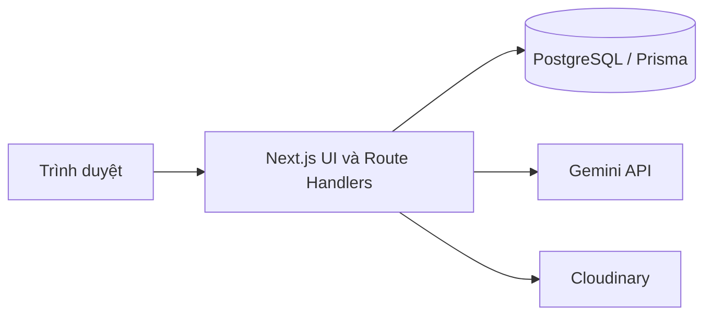
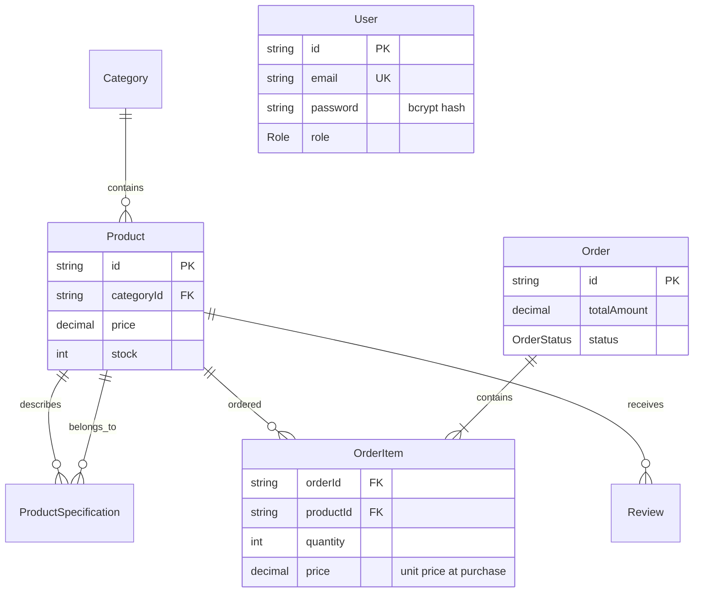

# Hưng Badminton

Website bán lẻ dụng cụ cầu lông, xây dựng với Next.js App Router, Prisma và PostgreSQL. Khách có thể tìm kiếm sản phẩm, quản lý giỏ hàng, đặt đơn COD và trò chuyện với trợ lý tư vấn sản phẩm dùng Gemini. Quản trị viên quản lý sản phẩm và xử lý đơn hàng.

## Kiến trúc

- **Giao diện và API:** Next.js App Router, React, TypeScript.
- **Dữ liệu:** PostgreSQL qua Prisma ORM.
- **Đăng nhập:** NextAuth Credentials; mật khẩu được băm bằng bcryptjs trước khi lưu.
- **Tư vấn sản phẩm:** Gemini API; danh sách sản phẩm đề xuất được đối chiếu lại với dữ liệu trong database.
- **Ảnh:** Cloudinary (cấu hình tùy chọn cho luồng tải ảnh).



### Quan hệ dữ liệu



Giá bán, giá tại thời điểm mua và tổng đơn dùng `Decimal`. Một sản phẩm chỉ xuất hiện tối đa một lần trong mỗi đơn. Hủy đơn chỉ được phép trước khi giao hàng và hoàn lại tồn kho trong cùng transaction với việc cập nhật trạng thái. Khóa thông số kỹ thuật là duy nhất trong từng sản phẩm; khi mở rộng catalog, hãy dùng nhãn nhất quán như `Trọng lượng`, `Điểm cân bằng`, `Độ cứng`, `Chất liệu` và `Lực căng tối đa`.

## Chạy dự án

Yêu cầu Node.js tương thích Next.js 16 (Node.js 20.9 trở lên) và PostgreSQL.

1. Cài dependencies:

   ```bash
   npm ci
   ```

2. Tạo `.env` từ `.env.example`, sau đó điền `DATABASE_URL` và `NEXTAUTH_SECRET`. Thêm `GEMINI_API_KEY` lấy từ Google AI Studio để bật tư vấn AI. Model mặc định là `gemini-3.5-flash-lite` để phản hồi nhanh; có thể đổi qua biến `GEMINI_MODEL`. Cloudinary chỉ cần thiết khi sử dụng tính năng tải ảnh.

3. Đồng bộ schema và nạp catalog mẫu:

   ```bash
   npx prisma db push
   npx prisma db seed
   ```

   Lệnh seed trên tạo danh mục và sản phẩm mẫu. Để tạo tài khoản quản trị, đặt `ADMIN_SEED_PASSWORD` (ít nhất 12 ký tự) rồi chạy:

   ```bash
   npx tsx prisma/admin-seed.ts
   ```

4. Khởi chạy:

   ```bash
   npm run dev
   ```

Mở [http://localhost:3000](http://localhost:3000). Không sử dụng mật khẩu mặc định; đặt secrets riêng cho từng môi trường. Với database đã có dữ liệu, sao lưu trước khi đổi kiểu tiền; kiểm tra các giá trị `Order.status` và xử lý các dòng đơn hàng hoặc khóa thông số bị trùng trước khi đồng bộ enum và unique constraints.

## API chính

| Method | Endpoint | Mô tả |
|---|---|---|
| `GET` | `/api/products` | Tìm kiếm, lọc và phân trang sản phẩm |
| `POST` | `/api/orders` | Tạo đơn COD; chỉ nhận thông tin giao hàng và `{ productId, quantity }` |
| `GET` | `/api/orders/list` | Danh sách đơn hàng (quản trị viên) |
| `POST` | `/api/ai` | Tư vấn sản phẩm và gợi ý sản phẩm liên quan |
| `POST` | `/api/auth/register` | Tạo tài khoản khách hàng |
| `POST` | `/api/admin/products` | Tạo sản phẩm (quản trị viên) |
| `PUT` | `/api/admin/orders/:id` | Chuyển trạng thái đơn theo quy trình hợp lệ (quản trị viên) |

Ví dụ tạo đơn:

```json
{
  "customerName": "Nguyen Van A",
  "phone": "0912345678",
  "address": "Hà Nội",
  "items": [
    { "productId": "00000000-0000-4000-8000-000000000000", "quantity": 2 }
  ]
}
```

Response thành công có dạng:

```json
{
  "success": true,
  "order": {
    "id": "UUID-don-hang",
    "totalAmount": "1230000",
    "status": "PENDING",
    "createdAt": "2026-10-28T09:00:00.000Z"
  }
}
```

Giá sản phẩm, phí vận chuyển và tổng tiền luôn được tính phía server. API kiểm tra schema và kích thước payload, giới hạn tần suất theo địa chỉ IP qua PostgreSQL, đồng thời trừ kho có điều kiện trong transaction để tránh bán vượt tồn kho. Đặt hàng giới hạn 20 dòng và tối đa 20 sản phẩm mỗi dòng; phí ship là 30.000₫, miễn phí từ 1.000.000₫.

Rate limit dựa trên địa chỉ IP do reverse proxy cung cấp; production cần cấu hình proxy để chuẩn hóa `X-Real-IP` hoặc `X-Forwarded-For`.

## Kiểm tra

```bash
npx prisma validate
npm run lint
npm run build
```

Repository hiện chưa có test runner hoặc bộ kiểm thử tự động.
